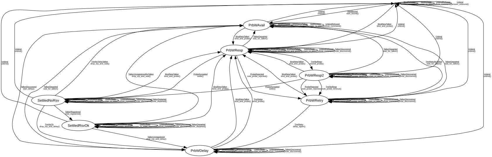

# Milan ACMP Listener Sink

**Implements:** Milan v1.3 Section 5.5.3

| Event | Unbound | PrbWAvail | PrbWDelay | PrbWResp | PrbWResp2 | PrbWRetry | SettledNoRsv | SettledRsvOk |
|-------|--------|--------|--------|--------|--------|--------|--------|--------|
| StartBound | start_bound() -> PrbWAvail | -x- | -x- | -x- | -x- | -x- | -x- | -x- |
| BindRefused | refuse_command() -> Unbound | refuse_command() -> PrbWAvail | refuse_command() -> PrbWDelay | refuse_command() -> PrbWResp | refuse_command() -> PrbWResp2 | refuse_command() -> PrbWRetry | refuse_command() -> SettledNoRsv | refuse_command() -> SettledRsvOk |
| BindSameTalker | -x- | update_binding() -> PrbWAvail | update_binding() -> PrbWDelay | update_binding() -> PrbWResp | update_binding() -> PrbWResp2 | update_binding() -> PrbWRetry | update_binding() -> SettledNoRsv | update_binding() -> SettledRsvOk |
| BindNewTalker | bind_and_probe() -> PrbWResp | bind_and_probe() -> PrbWResp | bind_and_probe() -> PrbWResp | bind_and_probe() -> PrbWResp | bind_and_probe() -> PrbWResp | bind_and_probe() -> PrbWResp | bind_and_probe() -> PrbWResp | bind_and_probe() -> PrbWResp |
| GetRxState | answer_rx_state() -> Unbound | answer_rx_state() -> PrbWAvail | answer_rx_state() -> PrbWDelay | answer_rx_state() -> PrbWResp | answer_rx_state() -> PrbWResp2 | answer_rx_state() -> PrbWRetry | answer_rx_state() -> SettledNoRsv | answer_rx_state_reserved() -> SettledRsvOk |
| UnbindRefused | refuse_command() -> Unbound | refuse_command() -> PrbWAvail | refuse_command() -> PrbWDelay | refuse_command() -> PrbWResp | refuse_command() -> PrbWResp2 | refuse_command() -> PrbWRetry | refuse_command() -> SettledNoRsv | refuse_command() -> SettledRsvOk |
| Unbind | answer_unbound() -> Unbound | unbind() -> Unbound | unbind() -> Unbound | unbind() -> Unbound | unbind() -> Unbound | unbind() -> Unbound | unbind() -> Unbound | unbind() -> Unbound |
| ProbeAccepted | -x- | -x- | -x- | settle() -> SettledNoRsv | settle() -> SettledNoRsv | -x- | -x- | -x- |
| ProbeRejected | -x- | -x- | -x- | note_probe_rejected() -> PrbWRetry | note_probe_rejected() -> PrbWRetry | -x- | -x- | -x- |
| TmrNoResp | -x- | -x- | -x- | resend_probe() -> PrbWResp2 | note_probe_timeout() -> PrbWRetry | -x- | -x- | -x- |
| TmrRetry | -x- | -x- | -x- | -x- | -x- | delay_again() -> PrbWDelay | -x- | -x- |
| TmrRetryNoTalker | -x- | -x- | -x- | -x- | -x- | wait_for_talker() -> PrbWAvail | -x- | -x- |
| TmrDelay | -x- | -x- | send_probe() -> PrbWResp | -x- | -x- | -x- | -x- | -x- |
| TmrNoTk | -x- | -x- | -x- | -x- | -x- | -x- | drop_srp_and_delay() -> PrbWDelay | -x- |
| TmrNoTkNoTalker | -x- | -x- | -x- | -x- | -x- | -x- | drop_srp_and_wait() -> PrbWAvail | -x- |
| TalkerDiscovered | -x- | start_delay() -> PrbWDelay | note_discovered() -> PrbWDelay | note_discovered() -> PrbWResp | note_discovered() -> PrbWResp2 | note_discovered() -> PrbWRetry | note_discovered() -> SettledNoRsv | note_discovered() -> SettledRsvOk |
| TalkerDeparted | -x- | -x- | wait_for_talker() -> PrbWAvail | wait_for_talker() -> PrbWAvail | wait_for_talker() -> PrbWAvail | wait_for_talker() -> PrbWAvail | note_departed() -> SettledNoRsv | note_departed() -> SettledRsvOk |
| TalkerRegistered | -x- | -x- | -x- | -x- | -x- | -x- | note_registered() -> SettledRsvOk | -x- |
| TalkerUnregistered | -x- | -x- | -x- | -x- | -x- | -x- | -x- | drop_srp_and_delay() -> PrbWDelay |
| TalkerUnregisteredNoTalker | -x- | -x- | -x- | -x- | -x- | -x- | -x- | drop_srp_and_wait() -> PrbWAvail |
