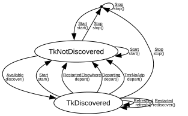

# Milan Listener Discovery

**Implements:** Milan v1.3 Section 5.6.4

| Event | Stopped | TkNotDiscovered | TkDiscovered |
|-------|--------|--------|--------|
| Start | start() -> TkNotDiscovered | start() -> TkNotDiscovered | start() -> TkNotDiscovered |
| Stop | stop() -> Stopped | stop() -> Stopped | stop() -> Stopped |
| Available | -x- | discover() -> TkDiscovered | -x- |
| Refreshed | -x- | -x- | refresh() -> TkDiscovered |
| Restarted | -x- | -x- | rediscover() -> TkDiscovered |
| RestartedElsewhere | -x- | -x- | depart() -> TkNotDiscovered |
| Departing | -x- | -x- | depart() -> TkNotDiscovered |
| TmrNoAdp | -x- | -x- | depart() -> TkNotDiscovered |
