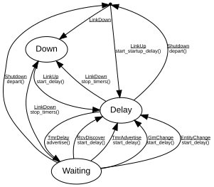

# ADP Advertise

**Implements:** Milan v1.2 Section 5.6.3; IEEE 1722.1-2021 Clause 6.2.4 (ADP Advertise)

| Event | Start | Down | Waiting | Delay |
|-------|--------|--------|--------|--------|
| LinkUp | start_startup_delay() -> Delay | start_delay() -> Delay | -x- | -x- |
| LinkDown | -> Down | -x- | stop_timers() -> Down | stop_timers() -> Down |
| RcvDiscover | -x- | -x- | start_delay() -> Delay | -x- |
| TmrAdvertise | -x- | -x- | start_delay() -> Delay | -x- |
| TmrDelay | -x- | -x- | -x- | advertise() -> Waiting |
| GmChange | -x- | -x- | start_delay() -> Delay | -x- |
| EntityChange | -x- | -x- | start_delay() -> Delay | -x- |
| Shutdown | -x- | -x- | depart() -> Start | depart() -> Start |
